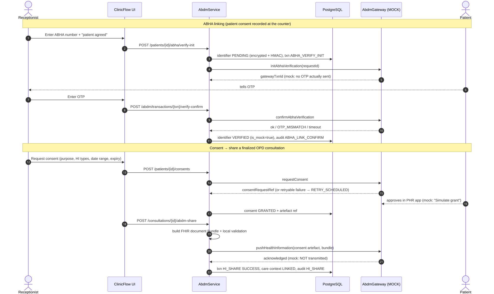

# ABDM integration architecture and mock workflows

> **All ABDM functionality in this PoC is simulated.** The `MockAbdmGateway` never contacts ABDM, never generates ABHA numbers, and every record it produces is stored with `is_mock = true` and labelled "Mock" / "Simulated" in the UI and API. The server refuses to start with any `ABDM_MODE` other than `mock`. Nothing here represents a real ABDM transaction or certifies ABDM compliance.

## Design

```
Patient / Clinical modules ──▶ AbdmService ──▶ AbdmGateway (interface)
                                   │                 ├── MockAbdmGateway   (shipped)
                                   │                 └── Live adapter      (future)
                                   ├──▶ FhirMapper (FHIR R4 + validation)
                                   └──▶ abdm_transactions / patient_consent_records / patient_identifiers / abdm_care_contexts
```

- **Separation:** ABDM logic lives only in `backend/src/abdm` and `backend/src/fhir`. Patient registration and consultation code doesn't know ABDM exists. The patient's internal ID is always the primary identifier, and ABHA is an optional linked identifier.
- **Port and adapter:** `AbdmGateway` defines the operations the clinic needs: initiate and confirm ABHA verification, request consent, push health information. The signatures are ClinicFlow's own abstraction. A live adapter maps them onto the ABDM specifications current at the time of integration.
- **Transaction log:** every gateway call has an `abdm_transactions` row with an idempotency `request_id`, type, status (`PENDING` → `SUCCESS` / `FAILED` / `RETRY_SCHEDULED` / `EXPIRED`), attempt count, gateway correlation id, error code and message, and a **non-sensitive** request/response summary (no raw identifiers or clinical content).
- **Retries:** transient failures (`retryable = true`) are rescheduled with exponential backoff (30 s × 2ⁿ, max 3 attempts). Health-information shares are retried by the background worker. Consent requests can be retried from the UI. OTP confirmations are never retried automatically.
- **No network I/O inside DB transactions:** gateway calls happen between two short transactions (record intent → call → record result).



## Workflows

### 1. ABHA linking (`AAC.1f`-oriented)

1. Staff enter an ABHA number (14 digits) or ABHA address (`name@domain`) and confirm the patient agreed to linking (required).
2. `POST /patients/{id}/abha/verify-init` stores a `PENDING` identifier (AES-256-GCM ciphertext, HMAC blind index, masked display value) and calls `initAbhaVerification`.
3. The patient shares the OTP. `POST /abdm/transactions/{txn}/verify-confirm` calls `confirmAbhaVerification`. On success the identifier becomes `VERIFIED` (with method and time).
4. Safeguards: one active link per ABHA across all patients, OTP session expiry (10 min), at most 3 failed confirmations, unlink with reason.

**Mock behaviour:** OTP `123456` succeeds, `999999` simulates a gateway timeout, anything else is "OTP mismatch". No OTP is sent anywhere.

### 2. Consent

1. `POST /patients/{id}/consents` with direction (`HIP_SHARE` / `HIU_REQUEST`), purpose (`CAREMGT`, `BTG`, `PUBHLTH`, `HPAYMT`, `DSRCH`, `PATRQT`), HI types (`OPConsultation`, `Prescription`, `DiagnosticReport`, …), date range and expiry (at most one year). A verified ABHA link is required.
2. The gateway returns a consent-request reference. The patient would approve or deny in their PHR app. **Mock:** `POST /consents/{id}/mock-respond` (`GRANT` / `DENY`) simulates this and is only available in mock mode.
3. Status handling: `REQUESTED` → `GRANTED` / `DENIED`. `GRANTED` / `REQUESTED` → `REVOKED` (withdrawal by staff, with reason). The worker moves anything past `expires_at` to `EXPIRED`. Gateway failure leads to `FAILED` (non-retryable) or stays `REQUESTED` with a scheduled retry.

### 3. Health-information sharing (HIP role)

1. `POST /consultations/{id}/abdm-share` requires a **finalized** consultation, a verified ABHA, and a `GRANTED`, unexpired `HIP_SHARE` consent covering `OPConsultation` or `Prescription` whose date range includes the visit.
2. A care context (`CC-…`) is created for the consultation.
3. `FhirMapper::consultationBundle` builds a FHIR R4 **document Bundle**, which is then checked by `FhirMapper::validateBundle`. A bundle with validation issues is not sent.
4. `pushHealthInformation` is called with the consent artefact reference. **Mock:** acknowledges and records "bundle was built and validated locally but NOT transmitted to ABDM".

Testing aid: `POST /abdm/mock/inject-failure` makes the next N calls of an operation fail (retryable or not). It is mock-only and audited.

## FHIR representation

| ClinicFlow record | FHIR R4 resource | Notes |
|---|---|---|
| Patient | `Patient` | Patient number as `MR` identifier. Verified ABHA added with placeholder system URIs (`urn:clinicflow:placeholder:abha-*`) that **must be replaced** with the ABDM-mandated systems. Tagged `MOCK-ABDM` when verification was simulated. |
| Doctor | `Practitioner` | Medical council registration as `MD` identifier |
| Clinic | `Organization` | HFR ID as identifier when configured |
| Appointment | `Appointment` | Status mapped to FHIR codes |
| Consultation | `Encounter` (class `AMB`) + `Composition` | Composition type SNOMED 371530004 "Clinical consultation report". Sections: chief complaints, allergies, history and diagnoses, physical examination, investigation advice, medications, follow-up. |
| Diagnosis | `Condition` | ICD-10 `http://hl7.org/fhir/sid/icd-10` / SNOMED `http://snomed.info/sct` / text |
| Vital signs | `Observation` (vital-signs category) | LOINC: BP panel 85354-9 (8480-6 / 8462-4), heart rate 8867-4, temperature 8310-5, respiratory rate 9279-1, SpO₂ 59408-5, height 8302-2, weight 29463-7. UCUM units. |
| Allergy | `AllergyIntolerance` | |
| Prescription item | `MedicationRequest` | Medication as text. Coding against SNOMED CT or the NRCeS drug registry is a roadmap item (NABH CMS IMS.1e). |
| Investigation order | `ServiceRequest` | LOINC coding when available |
| Bill | `Invoice` | Line items with base / discount / tax components |

Profiles: `meta.profile` declares the NRCeS ABDM canonical URLs the resources are **modelled after** (`https://nrces.in/ndhm/fhir/r4/StructureDefinition/DocumentBundle`, `…/OPConsultRecord`, `…/Patient`, etc.). Local validation checks required elements, coding shape, the Composition-first rule, unique `fullUrl`s and that every `urn:uuid` reference resolves. **Generic FHIR validity does not establish ABDM compliance.** Before any real exchange, validate with the official HL7 FHIR Validator loaded with the NRCeS implementation guide, for example:

```bash
java -jar validator_cli.jar bundle.json -version 4.0.1 -ig <NRCeS ABDM IG package>
```

FHIR endpoints: `GET /api/v1/fhir/{Patient|Practitioner|Organization|Appointment|Encounter|Invoice|Bundle}/{id}` and `GET /api/v1/fhir/Bundle/{consultationId}/validate`. Every export is audited (`FHIR_EXPORT`).

## Path to a live integration

1. **Registries:** register the clinic in the Health Facility Registry (HFR) and doctors in the Healthcare Professionals Registry (HPR). ClinicFlow already stores `hfr_id` and `hpr_id`.
2. **Sandbox onboarding:** obtain sandbox client credentials. Register the HIP/HIU bridge and callback URLs (the API must be reachable over HTTPS for gateway callbacks).
3. **Implement `LiveAbdmGateway`:** gateway session-token handling, request signing and encryption as specified, callback controllers that complete pending transactions (the transaction table already supports asynchronous completion via `gateway_txn_id`), care-context linking and discovery, and the health-information data-flow encryption (key exchange) required by the specifications.
4. **FHIR conformance:** replace placeholder identifier systems, add DiagnosticReport and Immunization records (NABH CMS IMS.1a minimum set), code medicines (IMS.1e), and pass the official validator.
5. **Certification:** complete NHA's functional and security certification for the relevant milestones (M1–M3). NABH CMS requires NHA approval before NABH certification.
6. **Configuration:** add `ABDM_MODE=sandbox|production` handling with credentials from a secret manager.

ABDM specifications, endpoints and onboarding steps change over time. Use the current documentation from NHA (https://abdm.gov.in and the sandbox portal) and NRCeS (https://www.nrces.in/ndhm/fhir/r4/index.html, the reference cited in NABH CMS IMS.1a) at the time of implementation.
