# Architecture

(Source: [diagrams/architecture.mmd](diagrams/architecture.mmd))

## Overview

ClinicFlow is a **modular monolith**: one C++ API process and one PostgreSQL database, with clear module boundaries so services can be split later if load or team structure justifies it. A single clinic doesn't need microservices, and avoiding them removes distributed-transaction and deployment complexity.

| Layer | Responsibility | Code |
|---|---|---|
| Web client | React + TypeScript SPA, hash routing, permission-aware navigation, client-side validation mirroring the server | `frontend/src` |
| Edge | nginx serves static files and reverse-proxies `/api` so the browser sees a single origin; CSP and security headers | `frontend/nginx.conf` |
| Controllers | HTTP routing, request parsing, authentication and permission checks, uniform error envelope, Swagger metadata | `backend/src/controller` |
| Services | Business rules and transactions per module | `backend/src/service`, `backend/src/abdm` |
| Interop | ABDM workflows behind the `AbdmGateway` port; FHIR R4 mapping and validation | `backend/src/abdm`, `backend/src/fhir` |
| Cross-cutting | Auth/RBAC, audit, crypto, notifications | `backend/src/security`, `backend/src/audit` |
| Data access | libpq connection pool, parameterized queries, transactions, SQLSTATE-aware errors | `backend/src/db` |
| Database | Schema, constraints, triggers, exclusion constraints, grants | `backend/migrations` |

## Module map

| Module | Owns tables | Depends on |
|---|---|---|
| Auth & admin | users, roles, permissions, role_permissions, user_roles, user_sessions, clinic_settings | audit |
| Patients | patients, patient_change_history, patient_allergies | audit, crypto |
| Scheduling | doctors, doctor_schedules, appointments, appointment_status_history, queue_tokens, notifications | audit, notifications |
| Clinical | consultations, vital_signs, consultation_diagnoses, consultation_addenda, prescriptions, prescription_items, investigation_orders, catalogues | audit, scheduling (appointment state) |
| Billing | service_catalogue, bills, bill_items, payments | audit (references patients/appointments by id only) |
| ABDM interop | patient_identifiers, patient_consent_records, abdm_transactions, abdm_care_contexts | audit, crypto, clinical (read), FHIR |
| Audit | audit_logs | — |
| Facilities (v0.2) | facilities | audit; sets the per-request clinic context used by row-level security |
| Dermatology (v0.2) | derm_assessments, clinical_photos, cds_*, suggestion_*, safety_overrides, prescribing_cases, treatment_outcomes, network_case_records, medication_interactions | clinical (as a `ConsultationExtension` called inside the finalize transaction), crypto (photo encryption, HMAC pseudonyms), audit. Pure logic in `derm/CdsEngine`, `derm/MedicationSafety`, `derm/PatternStats` |

## Key design decisions

1. **Oat++ for HTTP, libpq directly for data access.** In 1.3.0 the `oatpp-postgresql` ORM can't map `timestamptz`, `jsonb`, arrays or range types. The design depends on those for audit details, consent HI types and exclusion constraints. A thin wrapper (`Db`, `Conn`, `Row`, `Params`) keeps every query parameterized and transactional while staying close to SQL.
2. **Integrity in the database, not just the app.** Double-booking is prevented by a GiST exclusion constraint. Finalized consultations and prescriptions are locked by triggers. Payments and addenda are append-only. Money totals are enforced by CHECK constraints. Patient identifiers are immutable by trigger. A bug in the service layer can't silently corrupt clinical or financial records.
3. **Integer paise for money.** No floating point anywhere in billing. Discounts are allocated proportionally with deterministic remainder handling, and the same algorithm runs in the client preview and the server (`BillingMath`).
4. **Internal immutable patient identifier.** UUID primary key plus a human-readable patient number. Mobile numbers and ABHA identifiers are never keys. Mobile numbers are deliberately not unique, because families share phones.
5. **Server-side opaque sessions instead of JWT.** Only a SHA-256 of the token is stored. Logout, password change, deactivation and idle timeout take effect immediately, and a database leak doesn't expose usable tokens.
6. **Audit inside the business transaction.** An action and its audit record commit or roll back together. The hash chain is computed in SQL from the stored representation, so verification is exact.
7. **ABDM behind a port.** `AbdmGateway` isolates all ABDM interaction. The mock implementation is deterministic for tests and marks everything `is_mock`. A live adapter can be added without touching patient or clinical modules.
8. **Request bodies captured once.** A request interceptor reads every body before routing (with a 1 MB cap). Endpoints that don't need a body therefore can't leave bytes on a keep-alive connection. That bug was found by the end-to-end tests and has a regression test.
9. **Clinic timezone in SQL.** All timestamps are stored as `timestamptz` in UTC. "Today", slot generation and daily reports are computed in the clinic timezone (`Asia/Kolkata` by default), which avoids off-by-one-day errors around midnight UTC.
10. **No clinical decision support in the PoC.** A `ClinicalDecisionSupport` interface marks where a validated service would plug in. The UI states plainly that no interaction or allergy checking is performed, apart from a simple, clearly labelled name match against recorded allergies.

## Request lifecycle (example: finalize consultation)

1. `POST /api/v1/consultations/{id}/finalize` with a Bearer token.
2. `BodyCaptureInterceptor` drains the body. The route resolves to `ClinicalController::finalize`.
3. `auth(request, "clinical.finalize")` resolves the session (idle and absolute expiry), loads roles and permissions, and denies by default (an ACCESS_DENIED audit entry on failure).
4. `ClinicalService::finalize` opens a transaction, locks the row (`FOR UPDATE`), checks ownership, DRAFT status, chief complaint and diagnosis, finalizes the prescription and consultation, moves the appointment to COMPLETED and the token to DONE, and writes CONSULTATION_FINALIZE to the audit chain. Then it commits.
5. The response DTO is serialized. `SecurityHeadersInterceptor` adds `Cache-Control: no-store` and other headers.

## Scaling path

- **Horizontal API scaling:** the API is stateless apart from the database, so more instances can run behind a load balancer. The background worker uses `FOR UPDATE SKIP LOCKED` for notifications and should run as a single designated instance (or move to a job queue) for ABDM retries.
- **Multi-clinic:** add a `facility_id` to the clinical and financial tables plus row-level security.
- **Service extraction:** billing and ABDM interop are the natural first candidates. They already reference other modules by id only.

## Dermatology extension (v0.2)

- **Pure logic, thin services.** Matching, safety rules and pattern statistics are side-effect-free C++ functions with unit tests. `DermService` only loads data, calls them, and stores snapshots.
- **Extension point.** `ClinicalService::finalize` calls every registered `ConsultationExtension` inside its transaction. `beforeFinalize` can block finalization (safety acknowledgement). `afterFinalize` captures the coded case and the decisions atomically with the lock. A future specialty adds its own extension and frontend module, keyed by `consultations.specialty_code`.
- **Content is data.** Conditions, findings, red flags, medicine rules and interactions are database rows with a review status. Only `APPROVED` rows reach the engine. Starter content is generated from a Python data file into a migration.
- **Three panels, three sources.** A reads the knowledge base. B reads the doctor's own `prescribing_cases`. C reads `network_case_records`. They are fetched independently, shown side by side, and never merged into one recommendation.

See [DERMATOLOGY.md](DERMATOLOGY.md).
