# Database design

PostgreSQL 16, 37 tables, defined by 8 versioned migrations in `backend/migrations` (`V001`–`V008`). Migrations run automatically at API start (`Migrator`): each runs in a transaction, is checksummed, and refuses to start if an already-applied file was edited.

## Entity relationship diagram

(Source: [diagrams/erd.mmd](diagrams/erd.mmd). Only key columns are shown; see the migrations for full definitions.)

## Tables by module

| Migration | Tables |
|---|---|
| V001 core / security / audit | roles, permissions, role_permissions, users, user_roles, user_sessions, clinic_settings, id_counters, audit_logs |
| V002 patients | patients, patient_change_history, patient_identifiers, patient_allergies |
| V003 scheduling | doctors, doctor_schedules, appointments, appointment_status_history, queue_tokens, notifications |
| V004 clinical | medication_catalogue, investigation_catalogue, diagnosis_codes, consultations, consultation_addenda, vital_signs, consultation_diagnoses, prescriptions, prescription_items, investigation_orders |
| V005 billing | service_catalogue, bills, bill_items, payments |
| V006 ABDM | patient_consent_records, abdm_transactions, abdm_care_contexts |
| V007 reference data | permissions, system roles and grants, starter catalogues (40 medicines, 17 investigations with LOINC where known, 20 ICD-10 codes, 7 services) |
| V008 grants | least-privilege grants for `clinicflow_app` |

The brief's entity names map as follows: Users, Roles, Permissions, RolePermissions → `users`, `roles`, `permissions`, `role_permissions` (+ `user_roles`). Patients, PatientIdentifiers, PatientConsentRecords → `patients`, `patient_identifiers`, `patient_consent_records`. Doctors, DoctorSchedules, Appointments, QueueTokens → same names. Consultations, VitalSigns, Diagnoses, Allergies → `consultations`, `vital_signs`, `consultation_diagnoses`, `patient_allergies`. MedicationCatalogue, Prescriptions, PrescriptionItems, InvestigationOrders → same names. Bills, BillItems, Payments, AuditLogs, ABDMTransactions → same names.

## Keys and identifiers

- All entity primary keys are `uuid` (`gen_random_uuid()`), except `audit_logs` and history tables (`bigserial`, for ordering).
- `patients.patient_number` (unique, immutable by trigger) is the human-facing ID. `bills.invoice_number` is unique and generated from `id_counters` (gap-free, concurrency-safe upsert).
- ABHA values are never keys. `patient_identifiers.value_hmac` has a partial unique index (one active link per ABHA).

## Integrity constraints worth knowing

| Rule | Mechanism |
|---|---|
| No overlapping slot appointments for a doctor | `EXCLUDE USING gist (doctor_id WITH =, tstzrange(start_at,end_at) WITH &&) WHERE active` |
| No overlapping schedule blocks | exclusion constraint on `doctor_schedules` |
| Finalized consultation / prescription can't change or be deleted | `cf_consultation_lock`, `cf_prescription_lock` triggers; child-row triggers |
| Addenda, payments, audit logs append-only | `cf_audit_immutable` trigger + revoked UPDATE/DELETE grants |
| Bill arithmetic | `CHECK (total = subtotal - discount + tax)`, `discount <= subtotal`, `paid <= total`, `refunded <= paid`; per-line checks |
| Value ranges | CHECKs on vitals, mobile/PIN format, enumerations |
| Referential integrity | FKs with `ON DELETE RESTRICT` for clinical and financial data |

## Indexes

Trigram GIN indexes for name search (patients, medicines, investigations, diagnoses). B-tree indexes on mobile, DOB, appointment start / doctor / patient, bill dates and status, and audit time / user / entity / patient. Partial indexes for due notifications, pending retries and consent expiry.

## Data retention and deletion

- **Clinical records are never hard-deleted.** Corrections are addenda. Indian medical-record retention guidance (for example MCI/NMC regulations for outpatient records, and longer periods for medico-legal cases) should be confirmed for the clinic's state and policies.
- **Patients** are deactivated (`is_active = false`), not deleted, because FKs from clinical and financial history are `RESTRICT`.
- **Audit logs** are append-only. Retention is a policy decision (archive older partitions to WORM storage). A partitioning and archival job is on the roadmap.
- **Sessions** can be purged after expiry. **Notifications** can be purged after delivery plus a retention window.
- **Right to erasure (DPDP Act 2023):** health records kept under legal obligation are typically exempt from erasure. A process for handling data-principal requests (access, correction, consent withdrawal) is documented in SECURITY.md. Implementation of a formal workflow is on the roadmap.
